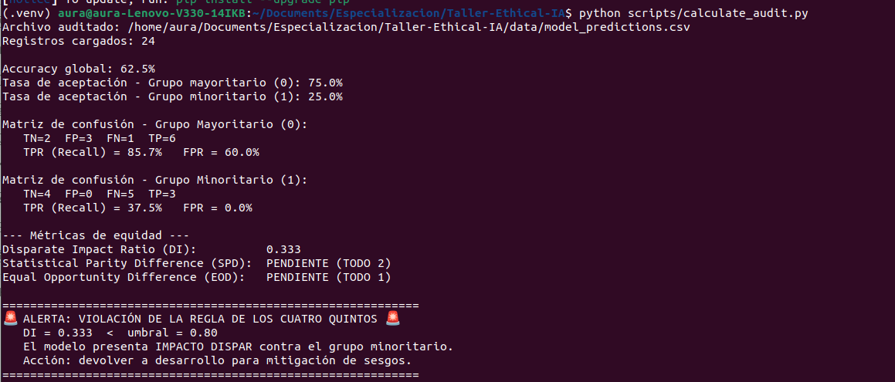
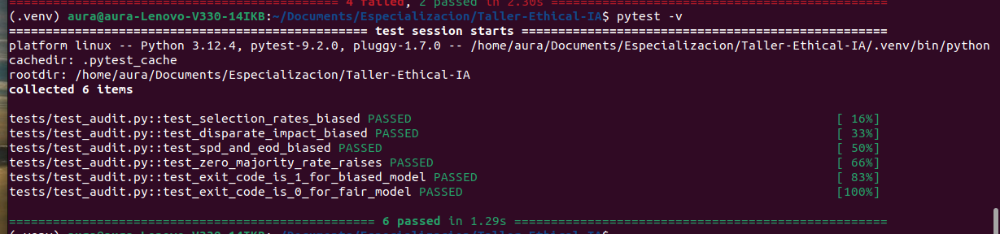
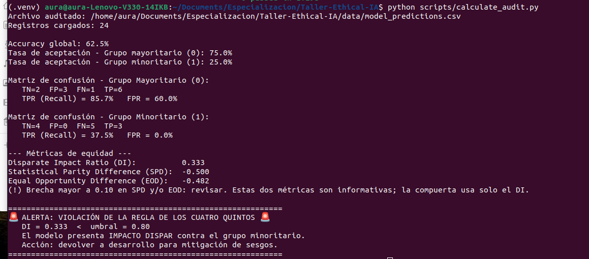
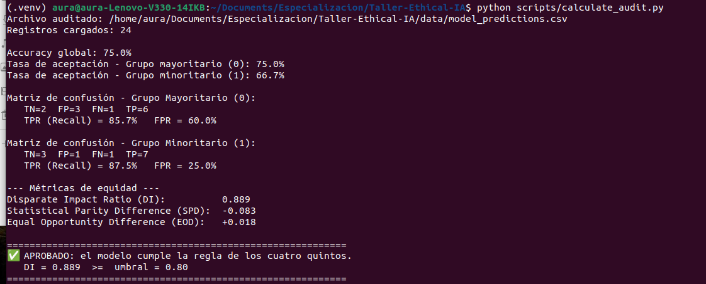

# Taller: Auditoría de Sesgo y Documentación de Modelos de IA

[](https://github.com/AuraAlba/Taller-Ethical-IA/actions/workflows/fairness-audit.yml)

> ✏️ **Reemplaza `<USUARIO>/<REPO>` del badge por los de tu repositorio.**

Taller práctico de 30 minutos. **No se entrena ningún modelo**: se audita uno ya
existente a partir de sus predicciones, se integra la auditoría en CI y se
documentan los resultados en una Model Card.

## 🎯 Objetivo

Al finalizar el taller serás capaz de:

1. Calcular métricas de equidad (**Disparate Impact**, **Statistical Parity Difference**,
   **Equal Opportunity Difference**) a partir de un CSV de predicciones.
2. Aplicar la **regla de los cuatro quintos** (DI ≥ 0.80) como criterio de aprobación.
3. Usar la auditoría como **quality gate en CI/CD** con GitHub Actions.
4. Documentar los hallazgos en una **Model Card**.

## 📁 Estructura

```
├── .github/workflows/fairness-audit.yml   # CI (no modificar)
├── data/model_predictions.csv             # Dataset a auditar
├── scripts/calculate_audit.py             # Script con 2 TODO por implementar
├── tests/                                 # Tests del script + datasets de referencia
├── MODEL_CARD_TEMPLATE.md                 # Plantilla de la Model Card
└── docs/img/                              # Aquí van tus capturas
```

## 🚀 Cómo empezar

Cada estudiante trabaja en **su propio repositorio público**, porque el CI de GitHub Actions
se ejecuta ahí. Clonar el repositorio del taller no basta: tu `git push` debe ir a tu repo, no al del docente.

### 1. Crea tu repositorio vacío en GitHub

1. Entra a <https://github.com/new>.
2. Nómbralo, por ejemplo, `bias-audit-workshop`.
3. Selecciona visibilidad **Public**.
4. **No marques** "Add a README", ".gitignore" ni "license". El repo debe quedar vacío.
5. Pulsa **Create repository**.

### 2. Clona el taller y apunta al repo que creaste

```bash
git clone https://github.com/<USUARIO_DOCENTE>/<REPO_DEL_TALLER>.git bias-audit-workshop
cd bias-audit-workshop

git remote set-url origin https://github.com/<TU_USUARIO>/<TU_REPO>.git
git branch -M main
git push -u origin main
```

Verifica que apuntas a tu repo y no al del docente:

```bash
git remote -v      # debe mostrar TU usuario, no el del docente
```

### 3. Comprueba que el CI está activo

1. Abre la pestaña **Actions** de tu repositorio.
2. Debe aparecer un run de **Fairness Audit CI** disparado por tu primer push.
3. Si ves un botón verde _"I understand my workflows, go ahead and enable them"_, púlsalo y relanza con **Run workflow**.

> Este primer run es **esperado**: `unit-tests` ✅ (con 2 tests _skipped_) y
> `fairness-gate` ❌. El modelo es sesgado a propósito; no es un error tuyo.

### 4. Actualiza el badge

Reemplaza `<USUARIO>/<REPO>` en la primera línea de este README por los tuyos.

### 5. Instala las dependencias (Python 3.9+)

```bash
python -m venv .venv
source .venv/bin/activate          # Windows: .venv\Scripts\activate
pip install -r requirements-dev.txt
```

## ▶️ Ejecución

```bash
python scripts/calculate_audit.py                    # audita data/model_predictions.csv
python scripts/calculate_audit.py --data <otro.csv>  # audita otro archivo
pytest -v                                            # tests del script
echo $?                                              # 0 = aprueba, 1 = viola la regla 4/5
```

---

## 📝 Pasos del taller

### Paso 1. Ejecuta el script tal como está

Corre el script sin modificar nada. Las métricas SPD y EOD deben aparecer como `PENDIENTE`.

**Evidencia 1: salida en consola (TODOs pendientes):**



### Paso 2. Implementa los TODO

En `scripts/calculate_audit.py` implementa:

- **TODO 1**: `equal_opportunity_difference` (TPR_min − TPR_maj)
- **TODO 2**: `statistical_parity_difference` (rate_min − rate_maj)

Verifica con `pytest -v`: los tests de SPD y EOD deben pasar de _skipped_ a _passed_.

**Evidencia 2: salida de `pytest -v` con TODOs implementados:**



**Evidencia 3: salida en consola sobre el dataset sesgado (TODOs implementados):**



### Paso 3. Primer push: la compuerta debe fallar

```bash
git add . && git commit -m "Implementa SPD y EOD" && git push
```

Ve a la pestaña **Actions** de tu repositorio.

> **¿Por qué hay un check en rojo?** El script no está roto. Detecta que el _modelo_
> es sesgado y devuelve `exit 1`. Eso es exactamente lo que debe hacer un quality gate.

| #   | Captura                   | Guárdala como                    | Qué debe verse                        |
| --- | ------------------------- | -------------------------------- | ------------------------------------- |
| 1   | Resumen del workflow      | `docs/img/ci-1-gate-rojo.png`    | `unit-tests` ✅ y `fairness-gate` ❌  |
| 2   | Log del job fallido       | `docs/img/ci-2-log-alerta.png`   | Mensaje de violación y el valor de DI |
| 3   | Pestaña _Summary_ del run | `docs/img/ci-3-summary-rojo.png` | Tabla con DI, SPD y EOD               |


### Paso 4. Mitigación simulada

Simula que el equipo de desarrollo corrigió el modelo (por ejemplo, ajustando el umbral de decisión del grupo minoritario):

```bash
cp tests/fixtures/fair_predictions.csv data/model_predictions.csv
```

**Evidencia 4: salida en consola tras la mitigación:**



### Paso 5. Segundo push: la compuerta debe pasar

```bash
git add . && git commit -m "Aplica mitigación simulada" && git push
```

| #   | Captura                   | Guárdala como                     | Qué debe verse      |
| --- | ------------------------- | --------------------------------- | ------------------- |
| 4   | Resumen del workflow      | `docs/img/ci-4-gate-verde.png`    | Ambos jobs ✅       |
| 5   | Pestaña _Summary_ del run | `docs/img/ci-5-summary-verde.png` | Tabla con DI ≥ 0.80 |


---

## 🧠 Reflexión

### A. Resultados

| Métrica                     | Dataset sesgado | Tras mitigación |
| --------------------------- | --------------- | --------------- |
| Accuracy global             | 62.5%           | 75.0%           |
| Tasa de aceptación, grupo 0 | 75.0%           | 75.0%           |
| Tasa de aceptación, grupo 1 | 25.0%           | 66.7%           |
| TPR, grupo 0                | 85.7%           | 85.7%           |
| TPR, grupo 1                | 37.5%           | 87.5%           |
| FPR, grupo 0                | 60.0%           | 60.0%           |
| FPR, grupo 1                | 0.0%            | 25.0%           |
| Disparate Impact (DI)       | 0.333           | 0.889           |
| SPD                         | -0.500          | -0.083          |
| EOD                         | -0.482          | +0.018          |
| ¿Pasa la regla 4/5?         | ☐ Sí ☑ No       | ☑ Sí ☐ No       |

### Cálculo manual de las tres métricas del dataset sesgado

1\. Disparate Impact (DI)

\\[ DI = \frac{0.250}{0.750} = \mathbf{0.333} \\]

2\. Statistical Parity Difference (SPD)

\\[ SPD = 0.250 - 0.750 = \mathbf{-0.500} \\]

3\. Equal Opportunity Difference (EOD)

\\[ EOD = 0.375 - 0.857 = \mathbf{-0.482} \\]


### B. Preguntas

**1. ¿La EOD coincide con la conclusión del DI? ¿Miden lo mismo? Justifica.**

Sí, en este caso coinciden en señalar un sesgo severo contra el grupo minoritario (tanto el DI de 0.333 como el EOD de -0.482 reprueban el comportamiento del modelo). Sin embargo, **no miden lo mismo**:

- **Disparate Impact (DI):** mide la **paridad demográfica o de selección** (\(P(\hat{Y}=1 \mid \text{min}) / P(\hat{Y}=1 \mid \text{maj})\)), independientemente de si los individuos están calificados o no.

- **Equal Opportunity Difference (EOD):** mide la **igualdad de oportunidad** comparando la Tasa de Verdaderos Positivos (\(\text{TPR}_{\text{min}} - \text{TPR}_{\text{maj}}\)), evaluando únicamente el rendimiento sobre el subconjunto de personas verdaderamente calificadas (\(\text{true\_label} = 1\)).

**2. Calcula qué proporción de cada grupo está realmente calificada (`true_label = 1`). ¿La brecha de aceptación se explica por mérito?**

**Cálculo con los datos de las matrices de confusión (dataset sesgado):**

- **Grupo 0 (Mayoría):** 
  - Calificados = TP + FN = 6 + 1 = 7.
  - Total de registros = 12.
  - Proporción de calificados = **58.33 %**.

- **Grupo 1 (Minoría):**
  - Calificados = TP + FN = 3 + 5 = 8.
  - Total de registros = 12.
  - Proporción de calificados = **66.67 %**.

**Conclusión:** **No, la brecha no se explica por mérito.** El grupo minoritario tiene una proporción mayor de personas calificadas (66.67 % frente a 58.33 %), pero el modelo solo aceptó al 25.0 % del grupo minoritario frente al 75.0 % del grupo mayoritario. La brecha de aceptación refleja un sesgo sistemático del algoritmo y no una falta de cualificación.

**3. ¿Cuántas personas calificadas del grupo 1 fueron rechazadas (FN)? ¿Qué implica en un caso real?**

**5 personas calificadas del grupo 1 fueron rechazadas** (\(\text{FN} = 5\), lo que representa un 62.5 % de falsos negativos en ese grupo).

**Implicación en un caso real (ej. crédito financiero o contratación laboral):** Implica una **denegación injusta de oportunidades y discriminación sistemática**. Personas que sí cumplen con los requisitos o perfil para el crédito/empleo son sistemáticamente excluidas por el algoritmo solo por pertenecer al grupo protegido, perpetuando barreras socioeconómicas y privando a la organización de contratar o prestar a candidatos aptos.

**4. Compara el FPR de ambos grupos. ¿Qué dice sobre los estándares que aplica el modelo a cada uno?**

**Comparación:**

- **FPR Grupo 0 (Mayoría):** 60.0 % (\(\text{FP}=3, \text{TN}=2\)).
- **FPR Grupo 1 (Minoría):** 0.0 % (\(\text{FP}=0, \text{TN}=4\)).

**Interpretación:** Muestra una **asimetría de estándares o doble rasero riguroso**. Para el grupo mayoritario, el modelo es extremadamente laxo o "perdonador": el 60 % de los no calificados recibieron una aprobación. Para el grupo minoritario, el modelo aplica una política ultra-conservadora o punitiva (0 % de falsos positivos), exigiendo requisitos desproporcionados antes de otorgar una predicción positiva.

**5. El accuracy global puede verse aceptable aunque el modelo sea inequitativo. ¿Por qué ocurre?**

Ocurre porque la métrica de **Accuracy global** agrega el total de aciertos (TP + TN) sobre el total de datos, enmascarando las diferencias de distribución de errores entre los subgrupos. Un modelo puede compensar un pésimo recall en el grupo minoritario (\(\text{TPR}=37.5\%\)) con un buen comportamiento o un volumen dominante en el grupo mayoritario (\(\text{TPR}=85.7\%\)), manteniendo un accuracy general aceptable (en este caso 62.5 %) a costa de ignorar la discriminación interna.

**6. El dataset tiene solo 12 registros por grupo. ¿Qué limitaciones tiene esta auditoría?**

- **Alta variabilidad estadística e inestabilidad de métricas:** Con una muestra tan pequeña (\(N=24\)), un solo cambio en una predicción (1 registro) altera el DI y las tasas en un 8.3 %, lo que genera un margen de error muy amplio.

- **Falta de representatividad e invalidez estadística:** No permite realizar pruebas de significancia estadística (como intervalos de confianza o pruebas *p-value*) para determinar si el sesgo detectado es intrínseco al modelo o producto del azar muestral.

**7. Propón dos mitigaciones técnicas reales (no la simulada) y un riesgo de cada una.**

1. **Optimización de Umbrales Post-procesamiento (Post-processing Thresholding / Equalized Odds Postprocessing):**
   - **Descripción:** Ajustar de forma independiente los umbrales de decisión (\(\tau_{\text{min}}\) y \(\tau_{\text{maj}}\)) sobre las probabilidades predichas para cada grupo para igualar la TPR o las tasas de selección sin reentrenar el modelo.
   - **Riesgo:** Puede implicar utilizar el atributo protegido directamente durante la inferencia para seleccionar el umbral, lo que en algunas legislaciones (como el Title VII en EE. UU.) se considera discriminación directa (*disparate treatment*).

2. **Remuestreo / Re-sopesado Pre-procesamiento (Pre-processing Reweighing):**
   - **Descripción:** Modificar la distribución de los datos de entrenamiento asignando pesos diferentes a los ejemplos de cada grupo (o remuestreando mediante *oversampling/undersampling*) para equilibrar la correlación entre la clase y el grupo protegido antes del entrenamiento.
   - **Riesgo:** Puede reducir la precisión global del modelo (*accuracy trade-off*) o causar *overfitting* en las instancias del grupo minoritario que reciben pesos excesivos.

### C. Conclusión: auditoría vs. Model Card

Compara los valores que escribiste en tu `MODEL_CARD.md` antes de ejecutar el script
(tus hipótesis) con los obtenidos en la auditoría.

## Tabla comparativa

| Métrica                     | Hipótesis (antes) | Obtenido (auditoría) | ¿Coincide? |
| --------------------------- | ----------------- | -------------------- | ---------- |
| Accuracy global             | 80.0 %            | 62.5 %               | No         |
| Tasa de aprobación, grupo 0 | 70.0 %            | 75.0 %               | No         |
| Tasa de aprobación, grupo 1 | 70.0 %            | 25.0 %               | No         |
| Disparate Impact            | 1.000             | 0.333                | No         |

### Conclusión (máx. 5 líneas)

Llenar una Model Card con estimaciones teóricas oculta sesgos críticos y transmite una falsa sensación de equidad. La comparación demuestra que solo una auditoría cuantitativa sobre predicciones reales revela el impacto dispar real (\\(\text{DI}=0.333\\)). El modelo original no es apto para despliegue, ya que violaría la regla de los cuatro quintos y discriminaría sistemáticamente al grupo minoritario.

---

## 📋 Model Card

1. Copia la plantilla: `cp MODEL_CARD_TEMPLATE.md MODEL_CARD.md`
2. Complétala con los resultados **reales** de tu auditoría sobre el dataset sesgado.
3. Verifica que la "Conclusión de la Auditoría" sea coherente con DI, SPD y EOD.

## ✅ Checklist de entrega

- [ ] TODO 1 y TODO 2 implementados; `pytest -v` sin _skipped_ ni fallos
- [ ] Evidencias 1 a 4 (salidas de consola) pegadas arriba
- [ ] 5 capturas de CI en `docs/img/` (3 en rojo, 2 en verde) y visibles en este README
- [ ] Sección Reflexión completa (A, B y C)
- [ ] `MODEL_CARD.md` completada
- [ ] Repositorio compartido con el docente

## 🧮 Rúbrica sugerida

| Criterio                                               | Puntos |
| ------------------------------------------------------ | ------ |
| Implementación correcta de SPD y EOD (tests en verde)  | 25     |
| Evidencias de CI (rojo y verde, con capturas legibles) | 25     |
| Reflexión: interpretación correcta de las métricas     | 25     |
| Model Card completa y coherente con la auditoría       | 25     |
